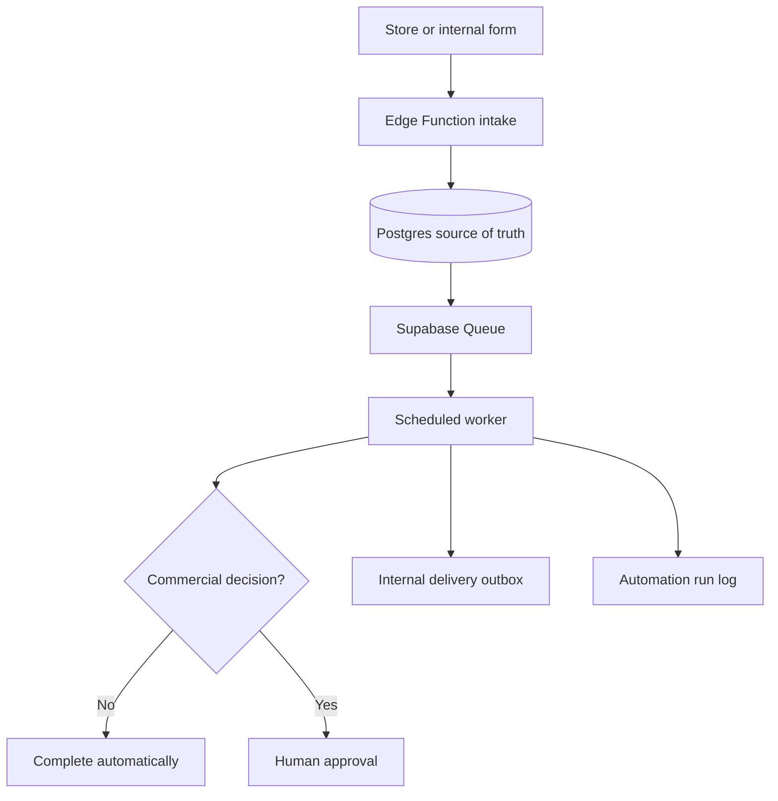

# Digital Product Automations

Supabase-native automation backend for the research-recommended **Documentary Shorts Factory OS** and later digital products. It turns the five reports into three durable, observable pipelines without making n8n the source of truth.

## What is implemented

### 1. Paid order → entitlement → delivery

`payment-webhook` verifies a Lemon Squeezy HMAC signature, records the raw event once, resolves the product, creates the customer/order/entitlement transactionally, and queues fulfilment. `automation-worker` prepares an internal delivery record for the active product version. Customer data and asset links remain inside Supabase until an exact email provider is selected and approved.

### 2. Evidence-backed product idea scoring

`submit-idea` accepts authenticated idea submissions with five 0–100 evidence measures. The worker applies the report's decision weights:

- demand: 30%
- low competition: 25%
- build feasibility: 20%
- founder fit: 15%
- evidence quality: 10%

Ideas scoring 70+ enter a human approval queue. Lower-scoring ideas remain recorded but do not consume production time. Scoring is deterministic and explainable in this release.

### 3. Feedback → classification → product change

`submit-feedback` uses an unguessable order feedback token. The worker classifies feedback, escalates high/critical issues, creates a change request, and opens a human approval. The deterministic fallback works without an AI subscription.

## Architecture



The database holds products and versions, assets, leads, customers, orders, entitlements, ideas, feedback, approvals, change requests, webhook events, outbound messages, and automation runs. All exposed business tables have RLS. Authorization is read from `workspace_members`, never editable JWT user metadata.

## Important launch rule from the research

Build readiness does not equal launch readiness. Keep paid fulfilment in test mode until either:

- 10 genuine preorders have been taken, or
- 100 people have joined the waitlist.

Before that threshold, fulfil the first cohort manually and record confusion points. The automation package is ready now so it can be switched on cleanly when validation is achieved.

## Local setup

Requirements: Docker Desktop and Node.js 22+.

```bash
cp .env.example .env
npx supabase start
npm test
npm run verify
```

The Supabase CLI created the migration file. Do not rename its timestamp. Deploy changes with the CLI or the Supabase integration after tests pass.

## First production setup

1. Create the first user in Supabase Auth.
2. Insert a workspace while authenticated. The owner membership is created automatically.
3. Insert the first product using an uppercase SKU, for example `DSFO_CORE`.
4. Insert an active semantic product version such as `1.0.0`.
5. Upload the ZIP/PDF assets to the private `product-assets` bucket using this path format:

   `WORKSPACE_UUID/PRODUCT_SKU/1.0.0/filename.zip`

6. Add each file to `product_assets` with the matching bucket/path and type `download`, `guide`, or `license`.
7. Add the Lemon Squeezy variant ID to `product_external_ids`, or send `product_sku` through Lemon Squeezy custom data.
8. Set Edge Function secrets from `.env.example`.
9. Deploy the five Edge Functions.
10. Configure the worker schedule using `supabase/cron.example.sql`, replacing both placeholders first.

Never put `SUPABASE_SERVICE_ROLE_KEY`, store webhook secrets, or `WORKER_SECRET` in frontend code.

## Future email adapter contract

### Email adapter

The worker sends:

```json
{
  "idempotency_key": "outbound-message-uuid",
  "to": "buyer@example.com",
  "template": "order_delivery",
  "data": {
    "products": ["Documentary Shorts Factory OS"],
    "deliverables": [{ "asset_id": "uuid", "label": "Core pack", "bucket_id": "product-assets", "object_path": "workspace/product/version/core.zip" }]
  }
}
```

The external sender is intentionally not deployed until you select and approve the destination (for example, n8n plus Resend). When added, it should generate short-lived signed links at send time and use `idempotency_key` to prevent duplicate mail during retries.

## Operational checks

- `automation_runs`: queued/running/waiting/succeeded/failed/dead-letter state.
- `approval_requests`: decisions that require an owner/admin.
- `webhook_events`: signature verification, idempotency, and processing errors.
- `outbound_messages`: delivery attempts and provider message IDs.
- Queue messages retry after their visibility timeout and dead-letter after five reads.

Run Supabase security and performance advisors after every schema release. Review failed runs before replaying them; do not blindly re-send delivery email.

## Current scope

This package automates the revenue-protection core. It intentionally does not scrape Etsy, Google Trends, or marketplaces, and it does not mass-generate unvalidated products. Those actions would contradict the strongest conclusion in the research: validate a narrow premium offer first, then automate repeated work.
