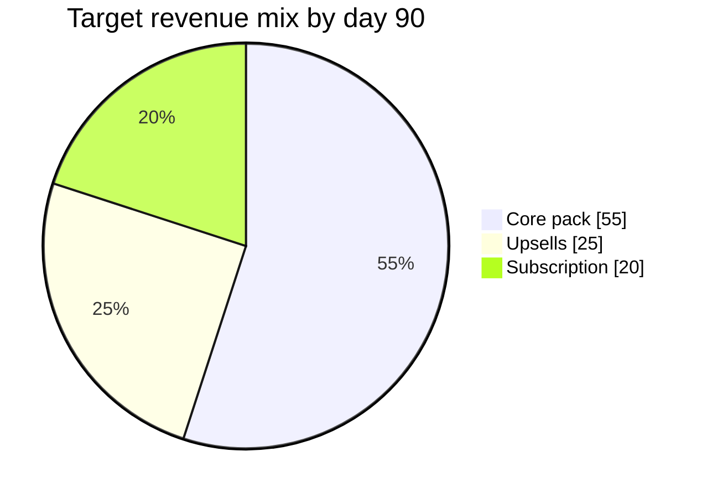
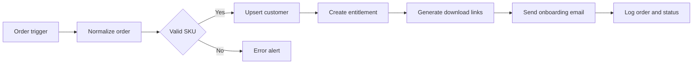

# Evidence-Based AI-Automated Digital-Product Business for Inshal Ijaz

## Executive summary

Using the founder profile supplied in the conversation, I optimized for products that reward a rare mix of skills rather than pure commodity scale: Adobe motion design, video editing, Midjourney/Runway/ElevenLabs, n8n/Zapier, and basic coding. Current marketplace evidence points to a clear pattern: demand is real, but much of the visible supply is low-trust, low-price, PLR-style volume dumping. On Etsy alone, the queries **Faceless Youtube**, **Youtube Shorts Template**, and **N8n Template** currently show roughly **2,000+**, **2,000+**, and **505+** items respectively, with many top listings priced between about **$0.70 and $10** and framed as “mega bundles,” “PLR/MRR,” or “done-for-you” packs. That is not a reason to avoid the category; it is evidence that the market exists and that the **gap is in premium, specific, maintained systems** rather than generic assets. citeturn48view0turn50view2turn52view0

The strongest three opportunities are:

1. **Creator automation operating systems for faceless educational and documentary shorts brands.** This niche has visible demand from creators buying automation and content systems, but the current supply is dominated by implausibly large, cheap template bundles that likely under-serve serious operators who need usable workflows, setup guidance, maintenance, and polished visual assets. citeturn52view0turn48view0

2. **Short-form quiz and explainer template systems for faceless channels.** Etsy demand is strong, but the visible offers skew toward Canva-only trivia packs, viral-reel bundles, and PLR content drops. There is room for a premium Adobe-native bundle that combines motion design, thumbnail systems, voice guidance, and publishing SOPs. citeturn50view2turn50view3

3. **Documentary map and infographic motion systems.** VideoHive alone lists **117,300+** After Effects templates overall and **1,900+** infographic templates, while Etsy’s **Infographic Template** market shows **5,000+** items, heavily weighted toward weddings, business slides, and generic presentations. That is precisely why a buyer-specific system for documentary YouTubers, newsletter creators, and explainer agencies looks attractive: the market is established, but the narrative-storytelling angle is not well served by the dominant generic/corporate supply. citeturn47view1turn64view0turn49view2

My recommendation is to start with **a premium creator automation operating system for faceless educational/documentary shorts creators**, validated first on **Etsy** because Pakistan is currently eligible for Etsy Payments via Payoneer, then migrate the winning offer to **Lemon Squeezy** for better control, higher AOV potential, subscriptions, lead magnets, discounts, global checkout, and merchant-of-record tax handling; Lemon Squeezy’s supported-countries page explicitly includes **Pakistan** for bank payouts. citeturn63view0turn61view0turn31view0turn32view0

The core strategic insight is simple: **do not sell “10,000 templates.” Sell a production system that removes uncertainty for one high-intent buyer.** Marketplace evidence suggests that generic bundles are competing on price and quantity; your edge is to compete on **outcome, polish, specificity, and support**. citeturn52view0turn50view2turn64view0

## Market signals and selection logic

I weighted sources exactly as requested. Tier one evidence came from official platform and infrastructure documentation, especially n8n docs, Lemon Squeezy docs, Etsy Help, Etsy Open API docs, OpenAI pricing docs, and object-storage vendor docs. Tier two evidence came from live marketplace category and search pages on Etsy, VideoHive, and Creative Market. Tier three evidence came from recent research and news about n8n’s real-world workflow patterns and security posture, which matters because the target business includes self-hosted automation. citeturn34view1turn34view2turn34view3turn61view0turn63view0turn33view3turn58view2turn40view1turn38view1turn44academia14turn46news1turn46news2turn46news3

The most important market observation is that **demand exists, but trust is scarce**. In the faceless-YouTube and YouTube-Shorts spaces, current Etsy results are filled with ultra-cheap PLR/MRR products, giant “viral reels” bundles, and generic automation ebooks. In the n8n space, there are already hundreds of listings, but many are bulk packs of thousands of workflows sold for the price of a coffee. That pricing structure strongly suggests a weak service layer, weak update discipline, and low buyer confidence about what actually works. For a premium operator, that is an opportunity. citeturn48view0turn50view2turn52view0

A second important observation is that platforms differ sharply in where they help you. Etsy gives discovery and visible buyer intent; Lemon Squeezy gives stronger economics and operating control. Etsy officially supports Pakistan for Etsy Payments, with Pakistan marked as a supported country via Payoneer. Lemon Squeezy’s docs say Pakistan is supported for bank payouts, and its pricing and feature set are far better suited to subscriptions, lead magnets, couponing, affiliates, and higher-ticket digital products. citeturn63view0turn61view0turn31view0turn32view0

A third observation is that automation infrastructure now matters commercially, not just operationally. n8n’s current docs emphasize persistent volumes, custom encryption keys, correct webhook configuration behind proxies, queue mode with Redis for scale, and different binary-data strategies in single-node versus queue mode. Recent 2026 coverage of multiple critical n8n vulnerabilities also means that security and version hygiene are part of the business model, not an afterthought. citeturn35view1turn35view2turn35view6turn35view7turn37view5turn55view0turn55view1turn46news1turn46news2turn46news3

The scoring below is an inference from the cited marketplace evidence and founder-skill fit.

| Niche | Demand visibility | Competition quality | Founder fit | Defensibility | Automation leverage | Overall view |
|---|---:|---:|---:|---:|---:|---|
| Creator automation OS for faceless educational/documentary shorts | 5 | 2 | 5 | 5 | 5 | Best overall |
| Quiz/explainer shorts template systems | 5 | 2 | 5 | 4 | 4 | Strong second |
| Documentary map and infographic motion systems | 4 | 3 | 5 | 5 | 3 | Strong premium niche |

The reason the first niche wins is not that it has less competition. It wins because the current supply appears **broader than it is deep**: a lot of sellers are offering sheer quantity, while relatively few appear to be selling a credible **workflow + asset + support + maintenance** package for one specific creator outcome. citeturn52view0turn48view0turn50view2

## Best niche opportunities

### Creator automation operating systems for faceless educational and documentary shorts brands

The ideal buyer is a solo creator, micro-agency, or faceless channel operator who wants a repeatable system for going from topic idea to published short-form content without assembling ten separate tools and SOPs. Their pain is not “I need more prompts.” Their pain is “I need a working system that saves me hours every week and still looks good on-platform.” That buyer already exists in the market, as shown by both the density of faceless-YouTube products and the dedicated n8n-template market. citeturn48view0turn52view0

Demand is visible in multiple places. Etsy’s **Faceless Youtube** market shows around **2,000+ items**, and many listings are digital downloads around channel kits, guides, reels bundles, and b-roll packs. Etsy’s **N8n Template** market shows **505+ items**, including many AI-automation and publishing bundles. This combination is unusually attractive because it ties two markets together: creator demand and automation demand. citeturn48view0turn52view0

The competitor pattern is revealing. Many n8n offers make very large claims at low prices, which creates a likely trust gap for serious operators. Below is a practical audit drawn from live Etsy results. The key conclusion is that the market is **crowded at the low end but under-built at the premium, specific, maintained end**. citeturn52view0

| Competitor | Platform | Visible price | Social proof | Main angle | Gap you can exploit |
|---|---|---:|---:|---|---|
| 300+ AI Agents & Automation Workflows for n8n | Etsy | $1.17 | 105 | Viral content + email bots | Too broad, low-trust bulk framing |
| 4000+ n8n Automation Templates Mega Bundle | Etsy | $1.25 | 255 | Social/media/business mega pack | Quantity > usability |
| 30000+ N8N Automation Workflows | Etsy | $0.70 | 79 | Plug-and-play mega claim | Credibility problem |
| 18000+ n8n Automation Templates Bundle | Etsy | $1.62 | 32 | Marketing/social media | No niche depth |
| 15300+ n8n Automation Templates Bundle | Etsy | $1.35 | 21 | No-code business automation | Little support implied |
| N8N Automation Bundle: AI Video Generator | Etsy | $1.65 | 10 | AI video/social poster | Promising but thin proof |
| 2000+ n8n AI Automation Workflows | Etsy | $3.27 | 463 | Marketing, leads, agents | Still generic |
| n8n Workflow Templates: No-Code Automation Bundle | Etsy | $7.00 | 72 | General bundle | Better price, still broad |
| AI Book Generator n8n Workflow | Etsy | $4.22 | 7 | Specific workflow | Narrow but not creator-video focused |
| Automated Faceless Video Creator | Etsy | $19.99 | 5 | Faceless video workflow | Strong signal but weak trust layer |
| Fully Automated AI Video Generation & Multi-Platform Publishing | Etsy | $9.99 | 12 | Publishing workflow | Setup/support likely thin |
| N8N YouTube Shorts Automation 2026 | Etsy | $9.99 | 5 | Shorts automation | Exactly your target area, but low proof |
| Etsy Order Dashboard Pro with n8n | Etsy | $37.00 | 153 | Analytics + BI | Higher-ticket proof that buyers do pay for specificity |
| n8n Database of 3000 templates | Etsy | $29.99 | 208 | Library/database | Supports premium price only when positioned as utility tool |

**Recommended product blueprint**

Sell a premium pack called **Documentary Shorts Factory OS**. This should be a concrete operating system for faceless educational/documentary shorts, not a “bundle.”

The asset stack should include the following exact deliverables:

| Layer | Assets |
|---|---|
| Strategy | niche-positioning worksheet, audience/problem matrix, 50 angle prompts, 30 hook formulas, 10 content pillars |
| Research | script-brief templates, source-confidence checklist, topic scoring sheet, evidence logging worksheet |
| Automation | 6 n8n workflows in JSON, setup videos, `.env` examples, Google Sheets/Airtable schema, webhook maps |
| Creative | 20 Premiere Pro sequences, 30 MOGRT title packs, 15 lower-thirds, 10 captions presets, 12 opener/outro variants |
| Visual systems | 40 PSD thumbnail templates, 20 Midjourney prompt boards, 10 Runway shot recipes, icon pack, LUT pack |
| Audio | 10 ElevenLabs voice-style sheets, pronunciation guide, pacing guide, sound-design checklist |
| Operations | SOPs for topic intake, QA review, publishing, update handling, support and refund workflow |
| Support | changelog template, workflow troubleshooting guide, version-compatibility notes |

**File formats:** `.json`, `.md`, `.pdf`, `.csv`, `.xlsx` or Google Sheets template links, `.mogrt`, `.aep`, `.prproj`, `.psd`, `.png`, `.cube`, `.wav`, `.txt`. The Adobe-native layer is one of the product’s main differentiators because many visible competitors are Canva-first or plain-JSON bundles. That creative-depth gap is the opportunity. citeturn52view0turn50view2

**Pricing ladder**

| Offer stage | Product | Price |
|---|---|---:|
| Lead magnet | 10 hooks + one free mini workflow + one thumbnail PSD | Free |
| Tripwire | Shorts Hook Kit + one publish workflow + 5 thumbnail templates | $9 |
| Core | Documentary Shorts Factory OS | $59 |
| Upsell | Adobe Motion Expansion Pack | $29 |
| Premium | Creator Setup Pack with onboarding videos and update access | $149 |
| Subscription | Monthly workflow updates + 20 hooks + 10 new templates + trend brief | $19/mo |

**Unit economics using Lemon Squeezy as the long-term checkout**

Lemon Squeezy’s official docs show a base platform fee of **5% + 50¢**, plus **1.5%** for international transactions and **1% payout fee** for bank accounts outside the US. The table below assumes bank payout outside the US, card payment, and token/storage/support costs on top. These are estimates, not quotes. citeturn32view0turn61view0

| Scenario | Selling price | Platform+payout estimate | Variable fulfillment cost | Contribution before fixed costs |
|---|---:|---:|---:|---:|
| Low | $29 | ~$2.68 | ~$1.50 | ~$24.82 |
| Base | $59 | ~$4.93 | ~$2.50 | ~$51.57 |
| High | $149 | ~$11.68 | ~$6.00 | ~$131.32 |

**Seven-day validation test**

Day one: publish a one-page Etsy listing mockup and one waitlist landing page for the core offer.  
Day two: post three niche-specific faceless breakdown clips showing before/after workflow speed and polish.  
Day three: DM ten small documentary/education shorts creators with a free sample thumbnail and ask one question: “Would a system like this save you time weekly?”  
Day four: release the free lead magnet and measure opt-ins.  
Day five: open a discounted preorder for the core pack.  
Day six: hold one live teardown or Loom walkthrough of one workflow.  
Day seven: decide go/no-go. Proceed only if you hit at least **100 waitlist signups**, **10 preorder sales**, or **5 buyers willing to answer setup questions**. That threshold is intentionally commercial, not vanity-based.

**Organic traffic plan**

The right traffic strategy is to market the transformation, not the files. The faceless-creator market is full of “here are 10,000 assets” offers. Your content should instead show **time saved, workflow clarity, and visual polish**. That positioning follows directly from the competitor gap visible on Etsy. citeturn48view0turn52view0

**Thirty short-form hooks**

“Why most faceless YouTube packs fail after day three.”  
“I rebuilt a faceless shorts workflow so one person can run it.”  
“Stop buying 10,000-template bundles you’ll never open.”  
“This is the only n8n workflow a faceless creator actually needs first.”  
“How I’d package a documentary shorts business as a system.”  
“Most automation templates break here.”  
“Here’s how to make AI-generated shorts look less AI-generated.”  
“Your bottleneck isn’t ideas, it’s operations.”  
“What a premium creator OS includes that cheap bundles never do.”  
“I turned one topic into a week of shorts in one workflow.”  
“This thumbnail system beats random prompt spam.”  
“Why template quantity is a trap.”  
“The difference between PLR junk and a production system.”  
“How to build a shorts machine without hiring a team.”  
“One workflow, three outputs, zero copy-paste.”  
“If I started faceless YouTube today, I’d sell this product first.”  
“Here’s the Adobe layer missing from most automation packs.”  
“The highest-margin digital products save labor, not clicks.”  
“I audited Etsy’s faceless bundles so you don’t have to.”  
“What serious creators buy after they outgrow Canva kits.”  
“This workflow turns rough briefs into publish-ready assets.”  
“How to validate a creator product in seven days.”  
“The safest way to automate without making your content generic.”  
“Why I sell outcomes, not ‘mega bundles.’”  
“What a $59 creator OS should include.”  
“The exact assets inside my shorts factory pack.”  
“How to turn one editing skill into subscription revenue.”  
“Why faceless creators need evidence logs, not just prompts.”  
“The simplest profitable automation product for creators.”  
“Don’t build workflow three until workflow one pays for itself.”

**Ten search-led content ideas**

Best n8n workflow for YouTube Shorts.  
Faceless YouTube automation setup.  
How to automate YouTube Shorts posting.  
Best thumbnail templates for documentary shorts.  
Premiere Pro templates for educational Shorts.  
n8n creator workflow.  
How to package automation as a digital product.  
Faceless documentary Shorts workflow.  
Best digital products for video editors.  
How to sell n8n templates on Etsy.

**Thirty-day organic schedule**

For days one through ten, publish one “problem teardown” clip daily and one SEO-led post every other day. For days eleven through twenty, publish one “before/after workflow demo” clip daily and one customer-question answer post every other day. For days twenty-one through thirty, publish one product-proof clip daily, one founder-opinion clip every three days, and one conversion CTA every three days. Repurpose each daily video into TikTok, Reels, Shorts, X thread, Pinterest idea pin, and Etsy listing-image refresh. The schedule is intentionally repetitive because repeatable formats outperform bespoke content in execution-heavy businesses.

### Short-form quiz and explainer template systems

This niche targets faceless creators, educators, and social-page operators who need repeatable vertical-video formats such as trivia, “would you rather,” visual explainers, countdowns, and lightweight educational shorts. Current Etsy demand is obvious: **Youtube Shorts Template** shows **2,000+ items**, and **Quiz Video Template** also has an established live market. But much of the visible inventory is still low-priced, Canva-led, and optimized for resell rather than proprietary brand systems. citeturn50view2turn50view3

The market is broad enough to support premium sub-positioning. Several listings show high review counts for quiz-style or hook-style products, which proves the format sells. The gap is that the best-performing visible offers are often either raw PLR video dumps or simple Canva templates; they usually do not combine **editing system, motion polish, thumbnail logic, voice guidance, and publishing SOPs** in one workflow-ready package. citeturn50view2

| Competitor | Platform | Visible price | Social proof | Main angle | Gap you can exploit |
|---|---|---:|---:|---|---|
| 5000+ Animated Gym Workout Reels Bundle | Etsy | $2.40 | 206 | Fitness faceless reels | Commodity bundle |
| Viral Reels Bundle: 100K+ AI Animated Shorts | Etsy | $0.72 | 420 | Viral reels PDF/bundle | Low-trust scale claim |
| 500K Viral Reels Bundle | Etsy | $1.23 | 103 | Mass PLR reels | Generic |
| 150+ Business and Motivation Video Template Pack | Etsy | $1.73 | 59 | Editable clips | Thin design layer |
| 700+ Viral Hooks Reels Bundle | Etsy | $2.09 | 628 | Hook clips | Not an operating system |
| Canva Video Template Trivia | Etsy | $5.24 | 814 | Trivia / faceless / Canva | Canva-first, limited polish |
| Canva Video Template, YouTube Shorts Template | Etsy | $5.97 | 6 | Trivia/Shorts | Weak proof |
| YouTube Shorts UI Overlay Animation Template | Etsy | $8.80 | 3 | Overlay/UI element | Narrow feature product |
| 30 YouTube Shorts Thumbnail Templates PSD | Etsy | $2.98 | 211 | Thumbnail pack | One slice of outcome |
| DaVinci Resolve YouTube Pack | Etsy | $2.74 | 98 | 500+ elements | Generic creator pack |
| YouTube Shorts Trivia Game Template | Etsy | $7.00 | 64 | Editable trivia design | Promising, but basic |
| Build Viral YouTube Channels with AI | Etsy | $22.17 | 140 | Templates + workflows | Broad and vague |

**Recommended product blueprint**

Build **Explainer Shorts Kit Pro** for either educators, finance creators, or history shorts creators. Do not target all of them at once. Pick one until the product proves itself.

Exact asset list:

- 50 vertical timeline templates in Premiere Pro  
- 20 MOGRT packs for quiz cards, counters, timers, lower-thirds, reveal transitions  
- 20 PSD thumbnail/storyboard sheets  
- 15 ElevenLabs voice-style presets and pronunciation sheets  
- 30 short-form script structures  
- 10 Midjourney prompt boards for B-roll and visual motifs  
- 10 Runway scene recipes for transition cutaways  
- 3 brand systems: minimal, high-energy, educational  
- 1 mini n8n publishing workflow  
- 1 hook bank, 1 posting SOP, 1 QA sheet, 1 title library

**File formats:** `.prproj`, `.mogrt`, `.psd`, `.json`, `.pdf`, `.csv`, `.txt`, `.png`, `.mp4`.

**Pricing ladder**

| Offer stage | Product | Price |
|---|---|---:|
| Lead magnet | 5 free vertical templates and 20 hooks | Free |
| Tripwire | 10 shorts templates + thumbnail mini-pack | $7 |
| Core | Explainer Shorts Kit Pro | $39 |
| Upsell | Niche expansion pack | $19 |
| Premium | Done-with-you customization guide and brand setup | $99 |
| Subscription | Monthly template drop + trend angles | $15/mo |

**Unit economics**

This niche has slightly lower plausible ASP than niche one, but lower support overhead. On Lemon Squeezy-style economics, a $39 core pack still leaves attractive contribution margin if the offer is premium enough to avoid refund-heavy bargain buyers. citeturn32view0turn61view0

| Scenario | Selling price | Platform+payout estimate | Variable cost | Contribution |
|---|---:|---:|---:|---:|
| Low | $19 | ~$1.93 | ~$1.00 | ~$16.07 |
| Base | $39 | ~$3.43 | ~$1.50 | ~$34.07 |
| High | $99 | ~$7.93 | ~$3.50 | ~$87.57 |

**Seven-day validation test**

Publish three preview clips in one chosen niche. Offer a free sample template and collect signups. Put up a preorder at $19 for the first 25 buyers. Success threshold: **75 signups**, **8 preorders**, or **3 creators asking whether the pack works with their current editor**.

**Organic traffic plan**

This niche wins when you create format envy. Show exactly how a boring short becomes more addictive with timers, reveals, counters, callouts, and better visual pacing.

**Thirty short-form hooks**

“Why your shorts die in the first second.”  
“The one transition format that keeps quiz videos watchable.”  
“Most trivia template packs are missing this.”  
“How to make faceless educational shorts look premium.”  
“Canva got you started; this gets you out of template jail.”  
“The easiest vertical-video product a video editor can sell.”  
“This timer pack fixes viewer drop-off.”  
“How I’d package a quiz channel system in 2026.”  
“The biggest mistake in faceless explainer visuals.”  
“How to make educational Shorts feel faster without over-editing.”  
“Three visual cues that improve retention.”  
“Why generic reels bundles don’t build brands.”  
“This is how I structure reveal-based shorts.”  
“The thumbnail system I’d use for a quiz brand.”  
“How to sound less robotic with AI voiceovers.”  
“What a premium trivia kit should really include.”  
“The editing stack behind better faceless videos.”  
“One style guide beats 5,000 random clips.”  
“How to sell templates without competing at $0.99.”  
“The Adobe-native upgrade path from Canva.”  
“Why niche-specific motion beats mega bundles.”  
“If you make history shorts, use this sequence.”  
“The exact lower-third style that works for explainers.”  
“How to turn template sales into recurring revenue.”  
“What buyers really want from Shorts kits.”  
“This is why your hook cards look amateur.”  
“I rebuilt a viral format pack for serious creators.”  
“From idea to editable sequence in minutes.”  
“The retention-first design language for faceless shorts.”  
“Don’t sell files; sell a repeatable show format.”

**Ten search-led content ideas**

YouTube Shorts trivia template.  
Premiere Pro YouTube Shorts template.  
Quiz video Canva alternative.  
Best faceless explainer video templates.  
Educational Shorts editing pack.  
Thumbnail templates for YouTube Shorts.  
How to make quiz shorts.  
Best vertical video assets for creators.  
How to sell shorts templates.  
Best templates for faceless educational channels.

**Thirty-day schedule**

Spend the first ten days on format-teardown content, the next ten on pack previews, and the last ten on customer-use cases and objections. Publish one demo clip daily, one search-led post every two days, and one CTA every three days. Focus on niche-specific examples, not generic “content creator” messaging.

### Documentary map and infographic motion systems

This is the most premium creative niche in the set. It serves documentary YouTubers, newsletter-media creators, explainer studios, education brands, and agencies producing research-heavy or story-heavy content. Demand is demonstrated by the sheer size of the global template market: VideoHive lists **117,300+** After Effects templates overall and **1,900+** infographic templates specifically, while Etsy’s **Infographic Template** market shows **5,000+** items. Yet current visible inventory on Etsy is heavily weighted toward weddings, PowerPoint bundles, and general business slide decks, and the visible VideoHive products are mostly generic infographic packs rather than narrative documentary systems. That mismatch is the gap. citeturn47view1turn64view0turn49view2

This niche is less obviously “viral” than the other two, but it is more defensible. Buyers here care more about polish, editability, and narrative usefulness than raw asset count. That fits the founder profile extremely well. citeturn64view0turn49view2

| Competitor | Platform | Visible price | Social proof | Main angle | Gap you can exploit |
|---|---|---:|---:|---|---|
| Liquid Glass Infographic | VideoHive | $16 | 9 sales | Stylish infographic | Generic |
| Simple Callouts | VideoHive | $19 | 9 sales | Callouts pack | Narrow |
| Circle Infographic | VideoHive | $15 | 5 sales | Diagram style | Corporate/general |
| Travelio \| Travel Maps | VideoHive | $20 | 4 sales | Travel map template | Promising but not documentary-focused |
| Motion Vibe | VideoHive | $65 | 2 sales | Text & motion presets extension | Tool-heavy, broad |
| Sci-fi HUD Elements | VideoHive | $35 | 5 sales | HUD pack | Genre-specific, not news/doc |
| Infographics | VideoHive | $37 | 64 sales | Broad infographic pack | Generic |
| infographic and map constructor | VideoHive | $30 | 110 sales | Maps + infographics | Strong signal; still generic |
| Corporate Timeline V01 | VideoHive | shown under $25 section | low sales | timeline pack | Corporate framing |
| United States Map Infographic Templates | Etsy | $7.50 | 673 reviews | PowerPoint/Illustrator/Slides | Presentation-first, not motion-first |
| Finance Infographic Templates | Etsy | $2.82 | 223 reviews | Canva social media | Static/canva |
| 3000+ Infographics Bundle | Etsy | $2.00 | 38 reviews | Business/data visualization | Quantity > specificity |
| Advanced Infographic Collection | Etsy | $5.99 | 77 reviews | Animated presentation infographics | Presentation-led, not story-led |

**Recommended product blueprint**

Create **StoryMap Motion System** for documentary and explainer creators.

Exact asset list:

- 12 animated world-map and regional-map systems in After Effects  
- 20 route, conflict-zone, spotlight, and chronology animation presets  
- 25 data-callout and annotation MOGRTs  
- 20 lower-thirds and source-card treatments  
- 12 chapter-title and “fact frame” systems  
- 10 color systems optimized for history, geopolitics, finance, science, and crime  
- 10 sound-design cue packs  
- 20 PSD thumbnail/source-card templates  
- 1 style guide for documentary pacing and hierarchy  
- 1 prompt board for AI-assisted visual generation  
- 1 asset-ingest n8n workflow to organize files and version notes  
- 1 usage-license and attribution worksheet

**File formats:** `.aep`, `.mogrt`, `.psd`, `.wav`, `.png`, `.pdf`, `.json`, `.txt`.

**Pricing ladder**

| Offer stage | Product | Price |
|---|---|---:|
| Lead magnet | 3 free lower-thirds + 1 map animation sample | Free |
| Tripwire | Documentary Title Pack | $12 |
| Core | StoryMap Motion System | $79 |
| Upsell | Niche add-on pack | $29 |
| Premium | Studio license + update pack + source-card bundle | $199 |
| Subscription | Monthly presets, maps, and chapter cards | $24/mo |

**Unit economics**

This niche should support the highest AOV because it offers stronger differentiation and lower direct comparability. The tradeoff is that it may have a slower purchase cycle than generic shorts packs.

| Scenario | Selling price | Platform+payout estimate | Variable cost | Contribution |
|---|---:|---:|---:|---:|
| Low | $39 | ~$3.43 | ~$2.00 | ~$33.57 |
| Base | $79 | ~$6.43 | ~$3.50 | ~$69.07 |
| High | $199 | ~$15.43 | ~$7.00 | ~$176.57 |

**Seven-day validation test**

Post five short teasers of map reveals, before/after documentary upgrades, and source-card systems. Publish a landing page with one animated sample and one “coming soon” waitlist. Secure at least **50 high-intent signups**, **5 preorders**, or **3 direct messages from documentary/explainer creators** before building the full pack.

**Organic traffic plan**

This niche is sold visually. The best content is not “look at my template pack.” It is “watch this boring doc clip become more credible and cinematic in 10 seconds.”

**Thirty short-form hooks**

“This tiny map animation change makes documentaries feel expensive.”  
“Why geopolitical videos look amateur without source cards.”  
“The most underrated digital product for video essay creators.”  
“How I’d package motion graphics for documentary channels.”  
“Most infographic packs are built for slides, not stories.”  
“This lower-third style instantly feels more credible.”  
“How to make research-heavy videos easier to edit.”  
“The map toolkit I wish existed for explainers.”  
“Why narrative creators need systems, not random presets.”  
“From static data to cinematic story frame.”  
“Making documentary visuals cleaner with one preset set.”  
“This title system fixes visual inconsistency.”  
“What premium explainer creators pay for.”  
“The difference between business infographics and story infographics.”  
“How to build a digital product around After Effects expertise.”  
“Why a map pack can beat a reel bundle on margin.”  
“The exact pack I’d sell to explainer channels.”  
“This is how I design source attribution screens.”  
“What makes motion graphics actually useful to editors.”  
“The documentary pack that should exist on the market.”  
“Why most infographic templates feel too corporate.”  
“One timeline preset, three narrative uses.”  
“The visual grammar of authority in research videos.”  
“How to sell to video essay creators without selling services.”  
“A better way to package Adobe expertise.”  
“What a studio license should include.”  
“How to show proof before launching a template pack.”  
“This motion system is built for editors, not designers.”  
“The cleanest way to animate facts and numbers.”  
“Why story-first motion beats flashy motion.”

**Ten search-led content ideas**

After Effects documentary templates.  
Map animation template for YouTube.  
Video essay motion graphics pack.  
After Effects infographic templates for documentaries.  
Source card template for YouTube documentary.  
Best lower thirds for explainer videos.  
How to animate maps in After Effects.  
Best motion graphics pack for YouTubers.  
How to sell After Effects templates.  
Documentary title templates.

**Thirty-day schedule**

Days one to ten: cinematic before/after clips. Days eleven to twenty: template breakdowns and timelapse creation clips. Days twenty-one to thirty: customer-use simulations, niche-specific examples, and preorder CTA clips.

## Recommended business and automation design

The best starting niche is the first one, but I would narrow it one step further:

**Specific starting offer:** **Documentary Shorts Factory OS for faceless educational and documentary Shorts creators.**

That product is strong because it combines all five founder advantages in one SKU: motion graphics, editing, AI generation, automation, and enough coding to make the workflows feel real rather than generic. The offer also has natural laddering into subscriptions, setup packs, niche expansions, and later studio licenses. The existing market evidence suggests that both creator-side demand and automation-side demand are already there; the gap is product quality and product specificity. citeturn48view0turn50view2turn52view0

The route from market investigation to mature automation should be staged deliberately.

```mermaid
flowchart LR
    A[Market evidence] --> B[Landing page + waitlist]
    B --> C[Preorder validation]
    C --> D[Manual MVP delivery]
    D --> E[Core pack refinement]
    E --> F[Workflow 1 sales and delivery automation]
    F --> G[Workflow 2 content ops automation]
    G --> H[Workflow 3 customer intelligence and updates]
    H --> I[Subscription and monthly drops]
    I --> J[Queue mode, workers, object storage, governance]
```



The **manual MVP** should come before serious automation. In practice that means shipping the first 10 to 25 customer deliveries with manual checkpoints even if parts are semi-automated. This lets you observe what breaks: unclear setup steps, missing file formats, Adobe-version compatibility, n8n credential issues, buyer confusion, and support load. Recent research on real-world n8n LLM workflows found that explicit reliability mechanisms such as fallback paths, repair loops, failure-specific alerts, and human approval gates are still relatively uncommon; that is a warning against over-automating too early. citeturn44academia14

The **mature offer structure** should look like this:

| Layer | What buyer gets | Why it matters |
|---|---|---|
| Core OS | workflow pack + assets + SOPs | immediate value |
| Expansion packs | niche-specific motion and thumbnails | raise AOV |
| Subscription | monthly updates and trend briefs | recurring revenue |
| Studio tier | team license + update SLA | higher-ticket growth |
| Services-lite | optional setup audit or migration guide | monetizes support without full agency work |

The revenue mix you want by day 90 is roughly this:



### Full product specification

The first commercial version should contain:

- 3 complete creator archetypes: history shorts, finance shorts, science shorts  
- 3 Adobe visual systems per archetype  
- 3 thumbnail systems per archetype  
- 3 voice/style sheets per archetype  
- 3 n8n workflows per archetype  
- 1 central evidence log and topic tracker  
- 1 compatibility matrix covering Adobe version, file types, and workflow dependencies  
- 1 “first publish in 45 minutes” quickstart  
- 1 troubleshooting tree  
- 1 update log and known-issues sheet

If you ship this at a professional standard, the product is no longer comparable to a $1.25 “4,000 templates” bundle. It becomes a business tool. That is your whole margin strategy. citeturn52view0

### AI model-routing plan with cost estimates

For model routing, keep the system simple and cost-aware. Use the cheapest model that can do the task reliably, and reserve deep-research-grade reasoning for high-value, low-frequency work.

| Task | Suggested model | Why | Example token profile | Estimated token cost |
|---|---|---|---:|---:|
| Hook variants, titles, caption rewrites | gpt-5.6-luna | cheapest reasonable drafting tier in retrieved pricing | 10k in / 5k out | about $0.04 |
| Structured brief synthesis, segmentation, FAQ drafting | gpt-5.6-terra | stronger reasoning at moderate cost | 20k in / 4k out | about $0.11 |
| High-stakes product copy, workflow instructions, support answers | gpt-5.6-sol | higher quality for customer-facing assets | 15k in / 4k out | about $0.20 |
| Weekly competitor/market synthesis | o3-deep-research | use sparingly for evidence-heavy research | 150k in / 20k out | about $1.15 in batch-mode token pricing |

These are **token-only** estimates based on official OpenAI API pricing retrieved today. OpenAI’s current pricing docs show short-context standard pricing of **$1 input / $6 output per 1M tokens for gpt-5.6-luna**, **$2.50 / $15 for gpt-5.6-terra**, **$5 / $30 for gpt-5.6-sol**, and batch pricing for **o3-deep-research** at **$5 input / $20 output per 1M tokens**. OpenAI also notes that tool-call pricing, such as file search/container pricing, applies separately where relevant. citeturn59view1turn59view3turn59view4

A good starting routing rule is:

- use **luna** for variants and repetitive marketing output  
- use **terra** for structured transformation and summarization  
- use **sol** for buyer-facing polished assets and instructions  
- use **o3-deep-research** once weekly for competitor scans, positioning updates, and pricing reviews

### Database schema

A lightweight Postgres schema is enough for the first 90 days.

```sql
create table leads (
  id uuid primary key,
  email text unique not null,
  source text not null,
  niche text not null,
  status text not null,
  created_at timestamptz not null default now()
);

create table products (
  id uuid primary key,
  sku text unique not null,
  name text not null,
  tier text not null,
  version text not null,
  active boolean not null default true
);

create table orders (
  id uuid primary key,
  platform text not null,
  external_order_id text not null,
  email text not null,
  product_sku text not null,
  gross_usd numeric(10,2) not null,
  net_usd numeric(10,2),
  created_at timestamptz not null default now()
);

create table entitlements (
  id uuid primary key,
  order_id uuid not null,
  license_type text not null,
  access_status text not null,
  expires_at timestamptz
);

create table content_ideas (
  id uuid primary key,
  niche text not null,
  angle text not null,
  score numeric(5,2),
  source_note text,
  status text not null,
  created_at timestamptz not null default now()
);

create table customer_feedback (
  id uuid primary key,
  email text not null,
  product_sku text not null,
  issue_type text not null,
  note text not null,
  severity text not null,
  created_at timestamptz not null default now()
);

create table workflow_runs (
  id uuid primary key,
  workflow_name text not null,
  entity_type text,
  entity_id text,
  outcome text not null,
  created_at timestamptz not null default now()
);
```

### Marketplace and payment eligibility for Pakistan

The strongest verified combination for this project is **Etsy for validation** and **Lemon Squeezy for controlled scale**.

Etsy officially lists **Pakistan** among countries eligible for Etsy Payments, and Etsy notes that countries marked with an asterisk, including Pakistan, can accept Etsy Payments with a **Payoneer Payment Account**. That makes Etsy a practical first-marketplace option for visible demand testing. citeturn63view0

Lemon Squeezy’s official supported-countries documentation explicitly lists **Pakistan** under bank payout countries and says merchants can receive bank or PayPal payouts in supported countries. Lemon Squeezy also offers digital downloads, subscriptions, bundles, lead magnets, affiliate tools, no-code checkout, and merchant-of-record tax handling, with a listed base fee of **5% + 50¢** plus certain add-ons. For a premium digital-product business, this is a strong long-term storefront and checkout layer. citeturn61view0turn31view0turn32view0

PayPal’s public country/region list retrieved today does **not** list Pakistan. I therefore treat platforms that depend primarily on a direct PayPal merchant setup as a risk area for a Pakistan-based founder, unless you separately verify an available payout rail through a supported intermediary. That conclusion is an inference from PayPal’s published list, not a standalone PayPal policy statement about Pakistani merchant onboarding. Confidence: medium. citeturn30view0

## n8n implementation guide

### Beginner Windows installation with Docker Compose

For a Windows beginner, the cleanest path is **Docker Desktop + WSL2 + a local Docker Compose stack**. n8n’s official Docker docs show persistent-volume usage, recommend setting `GENERIC_TIMEZONE` and `TZ`, and expose port `5678`. The Docker docs also show that persistent storage is important even when you use Postgres, because the `.n8n` directory still contains important data such as encryption keys and logs. citeturn35view0turn35view1turn35view2

**PowerShell steps**

```powershell
mkdir C:\n8n-local
cd C:\n8n-local
```

Create `.env`:

```dotenv
POSTGRES_DB=n8n
POSTGRES_USER=n8n
POSTGRES_PASSWORD=change-this-now
N8N_HOST=localhost
N8N_PORT=5678
N8N_PROTOCOL=http
WEBHOOK_URL=http://localhost:5678/
GENERIC_TIMEZONE=Asia/Karachi
TZ=Asia/Karachi
N8N_ENCRYPTION_KEY=replace-with-a-long-random-string
```

Create `docker-compose.yml`:

```yaml
services:
  postgres:
    image: postgres:16
    restart: unless-stopped
    environment:
      POSTGRES_DB: ${POSTGRES_DB}
      POSTGRES_USER: ${POSTGRES_USER}
      POSTGRES_PASSWORD: ${POSTGRES_PASSWORD}
    volumes:
      - postgres_data:/var/lib/postgresql/data

  n8n:
    image: docker.n8n.io/n8nio/n8n
    restart: unless-stopped
    ports:
      - "5678:5678"
    environment:
      DB_TYPE: postgresdb
      DB_POSTGRESDB_HOST: postgres
      DB_POSTGRESDB_PORT: 5432
      DB_POSTGRESDB_DATABASE: ${POSTGRES_DB}
      DB_POSTGRESDB_USER: ${POSTGRES_USER}
      DB_POSTGRESDB_PASSWORD: ${POSTGRES_PASSWORD}
      N8N_HOST: ${N8N_HOST}
      N8N_PORT: ${N8N_PORT}
      N8N_PROTOCOL: ${N8N_PROTOCOL}
      WEBHOOK_URL: ${WEBHOOK_URL}
      GENERIC_TIMEZONE: ${GENERIC_TIMEZONE}
      TZ: ${TZ}
      N8N_ENCRYPTION_KEY: ${N8N_ENCRYPTION_KEY}
      N8N_ENFORCE_SETTINGS_FILE_PERMISSIONS: "true"
      N8N_RUNNERS_ENABLED: "true"
      N8N_DEFAULT_BINARY_DATA_MODE: filesystem
    depends_on:
      - postgres
    volumes:
      - n8n_data:/home/node/.n8n

volumes:
  postgres_data:
  n8n_data:
```

Then run:

```powershell
docker compose up -d
docker compose ps
```

Open `http://localhost:5678` in your browser and create the owner account.

This setup is a Windows-adapted beginner stack, but the choices are grounded in current n8n docs: persistent volume, custom encryption key, Postgres support, timezone variables, and Docker Compose startup. n8n’s reverse-proxy docs also say that once you move behind a proxy you should set `WEBHOOK_URL` explicitly and set `N8N_PROXY_HOPS=1`. citeturn35view2turn35view3turn55view0turn55view1turn55view2

### Backup and restore

Use **two backup layers**: database backup and workflow/credential export.

n8n’s CLI docs show `n8n export:workflow --all`, `n8n export:credentials --all`, and matching import commands. They also document exporting with `--backup` and importing via `import:workflow`, `import:credentials`, or `import:entities`. citeturn37view0turn37view1turn37view2turn37view3

**Workflow and credential export**

```powershell
docker exec -it n8n-local-n8n-1 n8n export:workflow --all --output=/home/node/.n8n/backups/workflows.json
docker exec -it n8n-local-n8n-1 n8n export:credentials --all --output=/home/node/.n8n/backups/credentials.json
```

**Postgres backup**

```powershell
docker exec -t n8n-local-postgres-1 pg_dump -U n8n n8n > .\postgres-backup.sql
```

**Restore examples**

```powershell
Get-Content .\postgres-backup.sql | docker exec -i n8n-local-postgres-1 psql -U n8n -d n8n
docker exec -it n8n-local-n8n-1 n8n import:workflow --input=/home/node/.n8n/backups/workflows.json
docker exec -it n8n-local-n8n-1 n8n import:credentials --input=/home/node/.n8n/backups/credentials.json
```

Do not rotate the encryption key casually. n8n’s docs state that credentials are encrypted with the instance key, and in queue mode all workers must use the same `N8N_ENCRYPTION_KEY`. citeturn55view0

### Three maturity levels of n8n infrastructure

| Stage | Stack | Good for | Do not exceed |
|---|---|---|---|
| Solo starter | Docker Desktop, single n8n, single Postgres, local volume | validation and first sales | sustained high traffic or multi-user ops |
| Production single-instance | VPS, reverse proxy, SSL, Postgres, daily backups, object storage, monitoring | real revenue and one-person ops | heavy concurrent automation or multiple worker needs |
| Production scale | Postgres + Redis + n8n main + workers + object storage + external monitoring | subscriptions, frequent runs, larger customer base | none until governance becomes the next bottleneck |

n8n’s queue-mode docs state that queue mode provides the best scalability, requires Redis, and does **not** support filesystem binary storage in queue mode; if workflows need persistent binary data in queue mode, you should use S3-style external storage, and the binary-data docs say filesystem mode is unsuitable for queue mode. citeturn35view6turn35view7turn37view5

### Object storage and delivery strategy

Use this progression:

- **Stage one:** deliver via marketplace-native files or zipped assets attached to Lemon Squeezy order fulfillment.
- **Stage two:** move large files to **Cloudflare R2** or **Backblaze B2** with signed/private links.
- **Stage three:** front frequently downloaded previews through CDN-friendly storage.

Cloudflare’s R2 docs currently show **$0.015/GB-month** standard storage, **free egress**, and a free tier of **10 GB-month**, **1 million Class A operations**, and **10 million Class B operations** per month. Backblaze B2 currently advertises **$6.95/TB/month**, free egress up to 3x average storage, and free transactions for most common classes. AWS S3 is fully viable but usually less price-attractive for this business unless you need specific AWS integration depth. citeturn41view0turn41view1turn41view3turn38view1

My recommendation is simple: **start with marketplace-native delivery and local backups, then move to R2 when file counts and update frequency make version control painful**. That keeps ops light while avoiding premature architecture work. citeturn41view0turn41view1

### First three workflows

The first three workflows should follow revenue, not curiosity.

#### Workflow one

**Name:** `post_validation_sales_delivery`

**Trigger:** successful order from Etsy or Lemon Squeezy  
**Goal:** fulfill orders, provision access, log customer, send onboarding  
**Nodes:** Webhook or polling trigger → Set/Normalize Order → If product_sku valid → Postgres create/update customer → Create entitlement → Generate signed download links → Send Email → Create onboarding row in Sheets/Airtable → Slack/Telegram alert on failure



**Near-importable JSON skeleton**

```json
{
  "name": "post_validation_sales_delivery",
  "nodes": [
    { "name": "Order Trigger", "type": "n8n-nodes-base.webhook", "position": [240, 300] },
    { "name": "Normalize Order", "type": "n8n-nodes-base.set", "position": [460, 300] },
    { "name": "Valid SKU?", "type": "n8n-nodes-base.if", "position": [680, 300] },
    { "name": "Upsert Customer", "type": "n8n-nodes-base.postgres", "position": [900, 220] },
    { "name": "Create Entitlement", "type": "n8n-nodes-base.postgres", "position": [1120, 220] },
    { "name": "Create Download Links", "type": "n8n-nodes-base.code", "position": [1340, 220] },
    { "name": "Send Onboarding Email", "type": "n8n-nodes-base.emailSend", "position": [1560, 220] },
    { "name": "Log Order", "type": "n8n-nodes-base.googleSheets", "position": [1780, 220] },
    { "name": "Failure Alert", "type": "n8n-nodes-base.telegram", "position": [900, 420] }
  ],
  "connections": {
    "Order Trigger": { "main": [[{ "node": "Normalize Order", "type": "main", "index": 0 }]] },
    "Normalize Order": { "main": [[{ "node": "Valid SKU?", "type": "main", "index": 0 }]] },
    "Valid SKU?": {
      "main": [
        [{ "node": "Upsert Customer", "type": "main", "index": 0 }],
        [{ "node": "Failure Alert", "type": "main", "index": 0 }]
      ]
    },
    "Upsert Customer": { "main": [[{ "node": "Create Entitlement", "type": "main", "index": 0 }]] },
    "Create Entitlement": { "main": [[{ "node": "Create Download Links", "type": "main", "index": 0 }]] },
    "Create Download Links": { "main": [[{ "node": "Send Onboarding Email", "type": "main", "index": 0 }]] },
    "Send Onboarding Email": { "main": [[{ "node": "Log Order", "type": "main", "index": 0 }]] }
  }
}
```

#### Workflow two

**Name:** `content_idea_capture_and_scoring`

**Trigger:** n8n form, Google Sheet row, or Notion button  
**Goal:** capture topic ideas, score them, and route the best ones into production  
**Nodes:** Form Trigger → AI structured scoring → Set topic score → If score threshold → Postgres insert → Slack summary → else archive/low-priority

This workflow should not scrape marketplaces or violate terms. It should work on **your own topic intake and observed signals**, not automated scraping.

#### Workflow three

**Name:** `customer_feedback_update_loop`

**Trigger:** form submission, email label, or support-sheet row  
**Goal:** categorize issues, detect repeat complaints, and trigger update decisions  
**Nodes:** Trigger → AI classify → aggregate by issue type → if complaint count threshold → create changelog item → notify founder → send acknowledgement email

These first three workflows are intentionally boring. That is good. Boring workflows protect revenue. More sophisticated generation workflows can wait until the business has live proof.

## Execution plan, budgets, risks, and evidence ledger

### First fourteen days

| Day range | Primary objective | Output |
|---|---|---|
| Days one through three | pick the niche and ship a landing page | waitlist page + Etsy draft listing + free lead magnet |
| Days four through six | publish validation content daily | 6 short videos + SEO post cluster |
| Days seven through eight | run preorder test | discount offer + FAQ + objections sheet |
| Days nine through ten | interview buyers | 5 to 10 short discovery calls or async questionnaires |
| Days eleven through twelve | build manual MVP | first usable version of core pack |
| Days thirteen through fourteen | fulfill first buyers manually | feedback log + missing-assets list |

### Ninety-day plan

**Month one** is for validation and manual delivery.  
**Month two** is for refining the core pack, raising AOV, and building workflow one.  
**Month three** is for adding upsells, launching the subscription, and migrating operational pain points into workflows two and three.

A useful rule is this: if a task happens fewer than three times a week, keep it manual. If it happens five times a week and follows the same pattern, automate it. That keeps n8n working for the business, instead of the business working for n8n.

### Three budgets

| Budget | Monthly tools/infrastructure | Recommended use |
|---|---:|---|
| Lean | $50 to $150 | Etsy validation, Docker Desktop local n8n, minimal email tool, token-light model use |
| Base | $200 to $500 | Lemon Squeezy + domain + VPS + Postgres backups + R2 + regular model-assisted content ops |
| Growth | $700 to $1,500 | production VPS or managed host, queue-mode prep, subscription ops, object storage, monitoring, more frequent research and support tooling |

n8n Cloud’s current public pricing is useful as a benchmark even if you self-host: Starter is listed at **20€/mo annually** for **2.5K executions**, Pro at **50€/mo annually** for **10K executions**, while self-hosted business plans provide scaling options and higher governance features. Because this business benefits from asset storage control and custom workflow structure, self-hosting is strategically attractive once revenue justifies the maintenance. citeturn34view0

### KPI dashboard

| KPI | Why it matters | Target by day 30 | Target by day 90 |
|---|---|---:|---:|
| Waitlist conversion rate | validation quality | 20% | 25% |
| Preorder conversion from waitlist | willingness to pay | 5% | 8% |
| Core offer AOV | monetization quality | $29+ | $59+ |
| Refund rate | product fit | under 8% | under 5% |
| Onboarding completion rate | product usability | 70% | 85% |
| Support tickets per 10 orders | product clarity | under 4 | under 2 |
| Subscription attach rate | recurring revenue | 5% | 15% |
| Content-to-visit ratio | traffic efficiency | baseline | +30% vs month one |

### Risk register

| Risk | Evidence basis | Likelihood | Impact | Mitigation |
|---|---|---|---|---|
| Competing as a cheap bundle | obvious on Etsy faceless/n8n markets | High | High | sell a narrow premium system, not a mega bundle |
| Over-automating before proof | common builder error; research shows weak reliability patterns in real workflows | High | High | manual MVP first, automate only repeated pain |
| n8n security exposure | multiple 2026 critical issues reported | Medium | High | patch aggressively, private access, limit public endpoints, hardened environment |
| Payment/eligibility surprises | platform support differs by country and gateway | Medium | High | start with Etsy and Lemon Squeezy because Pakistan support is verified |
| File/version chaos | Adobe-heavy products create update drift | High | Medium | semantic versioning, changelog, compatibility matrix |
| Support overload | complex products can confuse buyers | Medium | High | create fast-start guides, known-issues sheet, workflow diagnostics |
| Weak niche positioning | “for creators” is too broad | High | High | pick one buyer: documentary/educational shorts creators |

### Security and compliance checklist

Keep n8n updated and do not expose stale instances publicly, especially given the 2026 critical vulnerability reports and the lack of workarounds for some cases other than patching or restricting endpoints. citeturn46news1turn46news2turn46news3

Set and preserve a custom `N8N_ENCRYPTION_KEY`; use the same key across workers in queue mode. citeturn55view0

Use persistent volumes for `.n8n` and database storage. citeturn35view0turn35view1

If behind a reverse proxy, set `WEBHOOK_URL` and `N8N_PROXY_HOPS=1`. citeturn55view1

Use `GENERIC_TIMEZONE=Asia/Karachi` to avoid schedule drift. n8n’s default timezone is America/New_York if not changed. citeturn55view2

On production stacks, move away from filesystem binary mode when using queue mode; use database or S3-compatible external storage instead. citeturn37view5turn35view7

If privacy requires it, n8n docs show you can disable diagnosis/version/templates calls back to n8n servers through environment variables. citeturn56view0

Log buyer consent, license status, version delivered, and update notices. This is business hygiene, not just compliance theater.

### Exact first ten actions

1. Choose **documentary/educational Shorts creators** as the first buyer.  
2. Name the product **Documentary Shorts Factory OS**.  
3. Build a one-page landing page and one Etsy draft listing.  
4. Create the free lead magnet with one PSD, one mini-workflow, and 10 hooks.  
5. Publish three proof clips showing the workflow and visual polish.  
6. Collect at least 25 waitlist signups before polishing anything else.  
7. Ask five potential buyers which part of the workflow scares them most.  
8. Open preorders at a discounted launch price.  
9. Deliver the first cohort manually and log every confusion point.  
10. Only then stand up workflow one in n8n.

### Evidence ledger

All sources below were accessed on **2026-07-10**.

| Source | What it proves | Limitations | Confidence |
|---|---|---|---|
| Etsy Help: Countries Eligible for Etsy Payments citeturn63view0 | Pakistan is eligible for Etsy Payments via Payoneer | Does not give fee economics | High |
| Lemon Squeezy Supported Countries citeturn61view0 | Pakistan is supported for bank payouts; MOR-style global merchant scope | Does not by itself prove every product type is allowed | High |
| Lemon Squeezy Pricing page citeturn31view0 | LS supports digital downloads, subscriptions, bundles, lead magnets, global checkout, tax handling | Marketing page, not legal terms | High |
| Lemon Squeezy Fees docs citeturn32view0 | 5% + 50¢ base fee, plus international/payout adders | Actual realized fees can vary by payment method/region | High |
| PayPal country list citeturn30view0 | Pakistan was not visible in retrieved PayPal country/region list | Absence-based inference, not a direct “unsupported” policy line | Medium |
| Etsy Faceless Youtube market page citeturn48view0 | 2,000+ items and concrete examples of low-price faceless bundles | Live marketplace pages change frequently | High |
| Etsy Youtube Shorts Template market page citeturn50view2 | 2,000+ items and concrete examples of shorts/trivia/PLR offerings | Same | High |
| Etsy Quiz Video Template market page citeturn50view3 | Dedicated quiz-template demand | Same | High |
| Etsy N8n Template market page citeturn52view0 | 505+ items and many low-priced n8n bundle competitors | Same | High |
| Etsy Infographic Template market page citeturn49view2 | 5,000+ items, mostly non-documentary inventory | Same | High |
| VideoHive After Effects category page citeturn47view1 | 117,300+ AE templates overall | Broad category, not your exact niche | High |
| VideoHive Infographics category page citeturn64view0 | 1,900+ infographic templates and example pricing/sales | Not all buyers are documentary creators | High |
| Creative Market social media page citeturn51view1 | Price points for YouTube/social template ecosystems | More design-template oriented than workflow-oriented | Medium |
| n8n Docker docs citeturn34view1turn35view0turn35view1turn35view2 | Persistent volume, timezone env vars, runners, Postgres examples | Linux-first examples adapted here for Windows | High |
| n8n Docker Compose docs citeturn34view2turn35view3 | Compose startup pattern and volume concepts | Official example includes Traefik and Linux commands | High |
| n8n Queue mode docs citeturn34view3turn35view6turn35view7 | Redis/workers/scaling requirements and queue-mode principles | Not a turnkey SMB architecture guide | High |
| n8n CLI docs citeturn37view0turn37view1turn37view2turn37view3 | Backup/export/import commands | Requires adaptation to your container names/paths | High |
| n8n encryption key docs citeturn55view0 | Credential encryption and requirement to share key across workers | Does not cover your full secret-management policy | High |
| n8n reverse-proxy webhook docs citeturn55view1 | `WEBHOOK_URL` and proxy-hop guidance | Only relevant once public-facing | High |
| n8n timezone docs citeturn55view2 | Default timezone and how to set `GENERIC_TIMEZONE` | Narrow operational point | High |
| n8n isolation docs citeturn56view0 | How to disable diagnostics/template/version-calling behavior | Isolation is not equivalent to full hardening | Medium |
| n8n public pricing page citeturn34view0 | Cloud/self-host benchmark pricing and scale features | Pricing can change | High |
| OpenAI API pricing docs citeturn59view1turn59view3turn59view4 | Token pricing for current model routing estimates | Costs exclude other platform/tool charges unless stated | High |
| Cloudflare R2 pricing docs citeturn41view0turn41view1turn41view3 | R2 storage/ops/egress economics | Usage-specific bill will vary | High |
| Backblaze B2 pricing page citeturn38view1 | B2 storage/egress economics | Region/usage specifics vary | High |
| n8n ecosystem research paper summary citeturn44academia14 | Real-world LLM workflows often lack robust fallback/reliability mechanisms | Academic summary, not official n8n policy | Medium |
| 2026 n8n vulnerability reporting citeturn46news1turn46news2turn46news3 | Security hardening and patching are commercially important | Secondary reporting, though consistent across sources | Medium |

**Start with Documentary Shorts Factory OS for faceless educational/documentary Shorts creators on Etsy, validate it by preorders plus waitlist conversion, and build post_validation_sales_delivery only after you reach at least 100 waitlist signups or 10 preorder sales.**