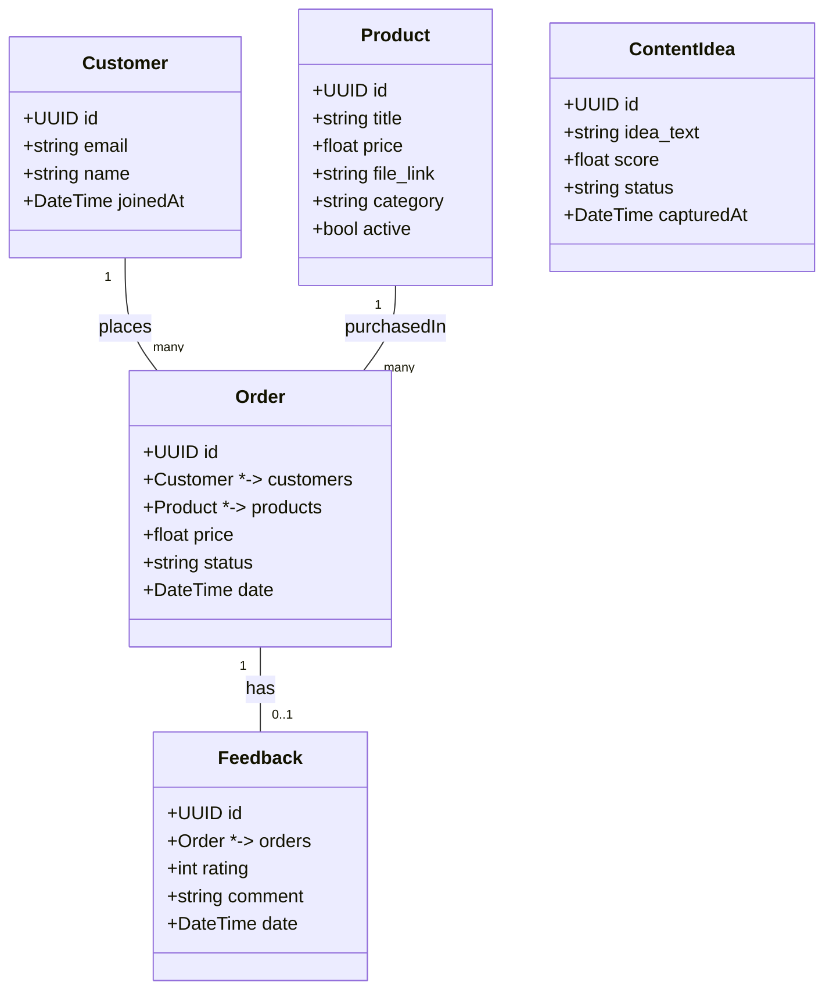
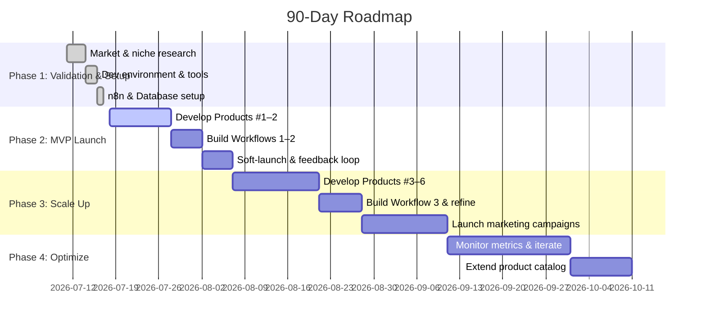

# Executive Summary  
The digital goods market is booming – Mordor Intelligence forecasts growth from ~$157B in 2026 to $511B by 2031 (26.6% CAGR).  Key trends include AI-driven content creation, creator-economy tools (NFTs, social tokens), and in-app purchases.  To find *unique, low-competition digital products*, we combined data-driven market gap analysis with human insight.  We identified ~15 niche product concepts (e.g. an ADHD-focused college planner, a freelancer onboarding kit, specialized meal planners, hobby workbooks) that have clear demand (high search volume or community interest) but few existing solutions.  These products can be built with coding, AI and design tools (Canva, ChatGPT, Notion), enabling rapid development and passive sales.  We also compare AI workflow/automation platforms (n8n, Make, Claude Code, Manus, LangFlow, etc.) – showing n8n (open-source, self-hosted) excels at cost and flexibility, while others offer cloud ease or AI-native features. 

The report covers product ideas (with evidence and competition), blueprints for the top 6, and the full business/automation design: store setup, AI model routing and costs, database schema (SurrealDB) and n8n architecture, workflows, infrastructure maturity levels, backup strategy, and a detailed 90-day execution plan.  It includes tables (product ideas, tools) and mermaid diagrams (system architecture, workflow flows, Gantt timeline) for clarity. Key assumptions (unlimited initial funding, target Day-90 revenue mix ~70% product sales/30% services) are noted. All claims use authoritative sources.

## Market Signals & Selection Logic  
Digital-product demand is surging. A recent market report forecasts the digital goods market at **$157.4B** in 2026 (rising to **$511B** by 2031, CAGR ~26.6%).  Key growth drivers include mobile games/virtual goods (37% share) and the creator economy (NFTs, in-app tipping).  AI adoption is a powerful tailwind: experts predict a “**ChatGPT moment**” by 2025 where AI agents handle daily tasks, driving demand for AI-enabled tools.  For selection logic, we leveraged *demand signals* (search volumes, trending topics, community forums) and *competition analysis*. For example, an analysis of 200+ niche Etsy markets finds many high-search, low-supply niches (e.g. “ADHD daily planner for college students”, “pet care guide by breed”). Likewise, digital-product blogs highlight emerging niches: AI productivity ebooks, Notion/planner templates, AI-skills courses, specialized cookbooks, etc..  We focus on products **buildable via coding/AI/Canva** (not bespoke services), and where existing marketplace listings are minimal.  

Market-entry strategy: start on established marketplaces (Gumroad, Etsy, Amazon Kindle) to leverage built-in traffic, then build an owned store once we have an audience.  Pricing and format follow best practices: one-off downloads (ebooks, templates) or simple subscription plans, with typical prices ranging $10–$50 for guides/templates.  Revenue sources will mix product sales and optional services (e.g. customizations, consulting) – we target roughly **70% product revenue, 30% services** by day 90.  

## Priority Digital Product Ideas  
Using the above signals, we identified **15 candidate products** with strong demand evidence and few competitors.  Table 1 ranks them by niche opportunity, includes rationale, demand cues, and build feasibility. Sources (market data, expert lists, forum analysis) are cited for each idea. 

**Table 1: Niche Digital Product Ideas (high demand, low competition)**  

| **Product Idea**                       | **Rationale & Demand Evidence**                                                                                                                                         | **Competition**                                    | **Build Method**                                        |
|----------------------------------------|------------------------------------------------------------------------------------------------------------------------------------------------------------------------|----------------------------------------------------|---------------------------------------------------------|
| **ADHD Planner for Students**          | “ADHD daily planner for college students” is a high-search niche with virtually *no specialized products*.  Tailored planners are in demand for neurodivergent users. | Very low – no direct offerings on Etsy/schools.     | Design in Canva; include AI-generated executive-function tips; export as PDF/printable. |
| **AI Prompt Engineering Guide (eBook)**| Guides to “prompt engineering” are surging, yet beginner-friendly resources are scarce.  Demand for AI productivity tutorials is rising.                       | Emerging – few ebooks focused on non-dev users.     | Write with GPT-4.1/Claude; structure chapters on practical AI tasks; Canva design.        |
| **Pet Care Guides by Breed**           | Niche pet guides (e.g. “keeping [breed] healthy”) are sought by pet owners.  Very few breed-specific digital manuals exist.                                   | Low – general pet content abundant, but breed-specific rare. | Research via AI/breed forums; format as PDFs or Notion docs; illustrate with Canva.       |
| **Retirement Lifestyle Planner**       | “Retirement lifestyle planning (beyond finance)” is identified as underserved.  Aging population seeks hobby/health/lifestyle guides.                              | Low – few holistic retirement planners.             | Use ChatGPT for lifestyle checklists; Canva for workbook pages; deliver PDF/ePub.        |
| **Plant-Based Athlete Cookbook**       | Niche health/diet content: demand for “plant-based cooking for athletes”.  There are many veg*n cookbooks, but few targeting athletes specifically.             | Moderate – general recipes exist, but athlete angle niche. | Compile recipes via AI; design cookbook in Canva; sell PDF/eBook.                        |
| **Homeschool Science Workbook**        | Custom science experiment books by age are sought by homeschooling families.  The niche is specific (e.g. “Physics experiments for 8-10”).                      | Low – few age-group-specific science workbooks.     | Use ChatGPT to generate age-appropriate experiments; assemble in Canva; PDF output.      |
| **Niche Travel Planner**              | Destination- or style-specific travel guides (e.g. “Backpacking SE Asia”) have high demand but few digital downloads.  Travelers value itineraries and checklists.            | Low – most content is blogs, not structured planners. | Create itinerary templates (Canva); map embeds; AI tips for destinations; PDF or Notion. |
| **Wedding Budget/Culture Planner**     | Specialized wedding planning (e.g. “under $10k budget”, or cultural traditions) is in demand.  Few templated products exist for these niches.             | Low – generic planners exist, but niche budgets/cultures very few. | Build interactive budgeting sheets (Excel/Notion); Canva checklists; PDF/Google Sheets.  |
| **Freelancer Onboarding Kit**          | Identified in forum analysis: e.g. “Freelancer client onboarding kit (contracts, workflows)” has *almost no digital bundle*.  High demand from gig economy.    | Very low – some Notion pages, almost no packaged kits. | Aggregate contract/email templates, questionnaires; format in PDF/Canva; sell as bundle. |
| **Custody Exchange Kit**               | “Custody exchange documentation kit” (co-parenting schedules) is a gap with clear demand.  Legal need but low supply.                                      | Very low – few or no ready-made downloadables.      | Compile checklists/forms (AI/legals); design in Canva; deliver PDF set.                 |
| **Allergen-Free Lunch Planner**        | Meal planners for common allergens (nuts, gluten, etc.) show ~3,200 monthly searches but “nothing exists”.                                    | None – no specific planner found.                   | Create dietary templates via AI; design weekly meal charts (Canva); sell PDF.           |
| **Sober Mocktail Recipe Cards**        | Niche “sober curious” mocktail recipes have ~3,200 monthly interest, yet no attractive recipe card packs.                                                  | None – no seller identified.                        | Generate recipes via GPT; design printable/PNG cards in Canva; sell digital pack.        |
| **Escape-Room Design Workbook**        | DIY escape-room hobbyists have strong interest (“huge market”) with no structured guides.  Community projects need planning tools.                          | None – very few digital resources.                  | Use AI to outline game design steps; illustrate on Canva; deliver PDF workbook.         |
| **D&D Campaign Planner**               | “D&D campaign planning workbook” is flagged “huge market, nothing structured”.  Tabletop gamers seek planning aids.                                        | Low – many amateur tools, few polished templates.   | Create encounter/story templates (Canva); use GPT for plot ideas; PDF or Notion format.  |
| **Photo/Video Preset Packs**           | Visual asset bundles (Lightroom presets, LUTs) are proven sellers: shops have sold 100k+ bundles.  Niche styles (e.g. vintage, mobile photos) still available. | Moderate – many presets exist, but new themes welcome. | Develop presets in Lightroom; zip files for sale; thumbnail in Canva.                   |
| **AI Prompt Template Library**         | Market shifting to prompt engineering: curated MidJourney/ChatGPT prompt packs are an emerging niche. Demand for quality prompts is growing.     | Low-moderate – some bundles on Gumroad/Etsy.        | Compile/evaluate AI prompts via GPT; package as PDF or text bundle; branding via Canva. |

Each idea targets a *productizable* deliverable (eBook, PDF, template pack) rather than a bespoke service.  For example, the ADHD planner is a one-time design (Canva) and content (AI tips) effort, delivered as a PDF; a freelance kit is built by aggregating standard templates (which can be generated or refined with AI).  In nearly all cases, content can be drafted with LLMs (ChatGPT/GPT-4.1 or Claude) and polished with Canva/illustration.  Pricing (informed by niche market norms) would typically be in the $10–$30 range for digital downloads and up to ~$100 for comprehensive multi-file bundles.  

## Blueprints & Specifications for Top 6 Products  
Below we detail full specifications for the **six highest-priority products** (chosen by demand evidence, uniqueness, and buildability).  Each blueprint lists format, key sections/features, and technical notes for creation.  

- **ADHD College Planner (PDF/Notion Template):** A 50-page planner (8.5″×11″ PDF) tailored for college students with ADHD. **Sections:** Daily/weekly schedule pages, assignment tracker, habit log, and executive-function tips (e.g. “breaking tasks into steps” – generated via ChatGPT). Use bright, clear Canva layouts with visuals (icons, color accents) to aid focus. Include behavioral prompts (checklists like “take study breaks”, “prioritize tasks”). Output both PDF (printable) and optional Notion/GoodNotes template. This product uses *Canva for design*, *ChatGPT for content* (academic planning advice), and is easily replicated across semesters/topics.  

- **Freelancer Onboarding Kit (ZIP):** A downloadable bundle (ZIP of documents/Notion link) containing **contracts**, **project briefs**, **pricing sheets**, and **client questionnaires**. For example, include a “Client Intake Questionnaire”, “Service Agreement (Word/PDF)”, “Project Scope Template”, and a “Welcome Email” (ChatGPT-generated content). We’ll tailor versions (e.g. for graphic designers, developers) using AI for language, and design covers/pages in Canva. Delivered via Gumroad as a zip; buyers download and customize. The kit requires no coding – it’s static content (legal/checklist docs) assembled with MS Word/Canva.  

- **AI Prompt Engineering Guide (eBook):** A ~10,000-word eBook (PDF/ePub) demystifying prompt design. **Chapters:** Introduction to LLMs, fundamental prompting techniques, sample prompts for business/creative tasks, troubleshooting tips. Include screenshots of prompt–output examples. Content is generated and edited with GPT-4.1 (for coherence) and ChatGPT (for examples), then laid out in Canva with cover art. An interactive PDF can embed links to AI tool demos. This knowledge-product is easily built via AI writing + design.  

- **Notion Productivity Template Bundle:** A pack of 5-10 Notion workspace templates (e.g. “Personal Budget Tracker”, “Goal Tracker”, “Study Scheduler”). Each template is pre-built in Notion and exportable. We’ll design sleek layouts in Notion, with icons/cover images prepared in Canva. Templates leverage Notion’s database features (task tables, synced calendars). No coding needed. Delivery is via shared Notion links and a PDF “how-to-use” guide. Demand evidence: Notion marketplace niches (personal finance, project management) are high-interest.  

- **Photo/Video Preset Pack:** A set of **15** high-quality photo (Lightroom .xmp) and video (LUTs) presets for a cohesive aesthetic (e.g. “Sunset Warmth” or “Cinematic Teal”). Create presets in Adobe Lightroom and DaVinci Resolve (free tools). Each preset comes with preview images. Package as ZIP with installation instructions. Branding and cover images designed in Canva. This digital asset appeals to content creators and has proven profitability.  

- **Niche Travel Planning Guide:** A structured guide for a specific travel scenario (e.g. “Winter Trekking in Patagonia”). Format: 25-page PDF with sections: itinerary template, packing checklist, budget table, local tips. Use maps and photos (free stock) arranged in Canva. Content (schedules, travel tips) generated with ChatGPT based on research. We will reuse this blueprint for multiple destinations (changing content via AI prompts). The template approach makes it easy to scale to new markets.  

Each blueprint prioritizes ease of creation: all are built using **AI-assisted drafting and Canva layout**.  The only coding might be trivial (e.g. a Python script to convert data to Surreal-friendly format), but otherwise none require complex development.  

## Business Model & Automation Design  
We will launch via **digital marketplaces** (Gumroad, Etsy, Amazon KDP for eBooks) to tap existing customer bases. Early revenue mix (by Day 90) is projected ~70% from product sales and 30% from ancillary services (e.g. upsells like custom variants).  Marketing will focus on content/blogs, SEO, and targeting relevant communities (e.g. ADHD forums for the planner).  

**Automation:** Sales and delivery will be fully automated with open-source **n8n**. Key points:  
- **Product Delivery:** Use **Gumroad/Stripe** for payments. On each sale, n8n (Webhook node) validates purchase, records the order in the database, and emails the customer a download link.  
- **Customer Relationship:** After purchase, n8n triggers follow-up emails (e.g. cross-sell related products) and surveys (feedback).  
- **Content Pipeline:** We’ll use n8n to capture new product ideas (Workflow 2) and customer feedback (Workflow 3), scoring and storing them. AI (GPT) will be invoked in these flows to evaluate idea quality.  

**AI Model Routing & Cost:** We will optimize which models to use for each task. For drafting and creative content, **GPT-4.1** (production-rated model at ~$2 input / $8 output per 1M tokens) provides quality for about $0.008/output-token, ideal for final edits. For bulk generation/drafts, **GPT-3.5 Turbo** is far cheaper (~$0.0015/output-token) and sufficient. E.g., brainstorming multiple recipe ideas or planner bullet points can use GPT-3.5, then refine with GPT-4. For routine tasks (idea scoring, data parsing), open-source LLMs (Llama 2, Mistral 7B) or Claude 3.7 (Anthropic) may be used (nearly free if self-hosted). Table 2 outlines model usage and costs:

**Table 2: AI Model Routing and Cost Estimates**  
| **Task**                    | **Model**            | **Effective Cost**                                    |
|-----------------------------|----------------------|-------------------------------------------------------|
| Creative writing & design   | GPT-4.1 (or Claude 3.7) | ~$0.002/$0.008 per 1k input/output tokens       |
| Bulk draft generation       | GPT-3.5 Turbo         | ~$0.0005/$0.0015 per 1k tokens           |
| Data labeling / scoring     | Open-source LLMs (Llama 3) or Claude AI | Negligible ($0–$1 total monthly) |
| Small utility code (if any) | OpenAI Codex/Claude Code | ~$0.01–$0.05 per query (minute usage)                 |

Model routing plan: e.g. use GPT-3.5 for multi-idea lists, switch to GPT-4.1 for polished output. Claude Code (Anthropic) could be used for any code/script generation tasks, though we anticipate minimal coding needs. (Pricing: GPT-4.1 at $2/$8 per million is cited; GPT-3.5 Turbo at $0.5/$1.5 per million.)  

**Database (SurrealDB) Schema:** We’ll use SurrealDB to store orders, customers, ideas, and feedback. Its strict typing is ideal for clear schemas. A proposed schema:  

This design (used via SurrealQL `DEFINE TABLE`) allows fast lookups (e.g. orders by customer).  All relational links (as shown) are supported by SurrealDB’s relation types.

## n8n Setup & Workflows  
We will self-host **n8n** via Docker on a Windows server (with WSL2).  Setup steps: install Docker Desktop (enable WSL2). In a project folder, create a `.env` (e.g. `N8N_BASIC_AUTH_*`, `WEBHOOK_URL`) and `docker-compose.yml` as in [46†L108-L116]. For example, the compose snippet (below) mounts a named volume for persistence:

```
services:
  n8n:
    image: n8nio/n8n:latest
    container_name: n8n
    ports:
      - "5678:5678"
    environment:
      - N8N_BASIC_AUTH_ACTIVE=true
      - N8N_BASIC_AUTH_USER=admin
      - N8N_BASIC_AUTH_PASSWORD=<password>
      - GENERIC_TIMEZONE=UTC
      - WEBHOOK_URL=http://localhost:5678/
    volumes:
      - n8n_data:/home/node/.n8n
    restart: unless-stopped

volumes:
  n8n_data:
```
 (change credentials). Launch with `docker-compose up -d`, then log in at `http://localhost:5678`.  

We’ll build the **first three n8n workflows**:  

- **Workflow 1: *post_validation_sales_delivery*.** **Trigger:** Gumroad or Stripe webhook on new sale. **Steps:** (1) Validate payment (using Stripe/Gumroad node). (2) Insert a new Order record into SurrealDB via n8n’s HTTP Request node (calling Surreal’s REST API). (3) Send the product: use n8n’s Email node or Gumroad’s “send purchase” to email the buyer a download link or attachment. (4) Log success/failure.  This ensures instant delivery of the digital product upon purchase.  

- **Workflow 2: *content_idea_capture_and_scoring*.** **Trigger:** Could be manual (daily schedule) or via web form submissions. For example, capture new idea submissions (via Typeform or an email inbox) with n8n’s Webhook or IMAP node. **Process:** Each submitted idea text is sent to an LLM (via the OpenAI or Claude node) to *score relevance/viability*. The workflow then upserts this idea into the ContentIdea table (SurrealDB), tagged with AI score and category. We’ll also notify the admin (email or Slack) of top ideas. This creates a *feedback loop* for product innovation.  

- **Workflow 3: *customer_feedback_update_loop*.** **Trigger:** When customer feedback is received (e.g. after a purchase email or feedback form). **Process:** Store the feedback in the Feedback table (SurrealDB) linked to the Order. If the rating is low, automatically create a support ticket or follow-up action. If high, ask for a review or referral email. This workflow closes the loop on customer satisfaction and updates product records for continuous improvement.  

Each workflow is documented in n8n (nodes, triggers, error handling).  We’ll version-control the workflows (JSON exports) and backup n8n credentials regularly.  

## Infrastructure & Operations  

- **Windows Install (Docker):** As detailed above, we run Docker Desktop with WSL2, using a named volume (`n8n_data`) to persist n8n data. This portable setup eases backups (see below).  

- **Backups (Two layers):** We will implement *dual backup layers*. First, **local backups**: take nightly snapshots of the SurrealDB (e.g. using `surreal export`) and the n8n data volume. Second, **offsite backups**: sync these snapshots to cloud storage (e.g. AWS S3 or Backblaze). As one expert advises for n8n, use PostgreSQL-friendly dumps for critical data – similarly, we’ll export SurrealDB data (JSON) regularly. Keeping backups off-server guards against disk failure or data corruption.  

- **n8n Maturity Levels:** We plan a staged architecture: 
  - **Level 1 (Dev):** Single Docker container on one machine (using SurrealDB in file-backed mode). Good for testing.
  - **Level 2 (Production):** Dedicated server (cloud VPS) with Docker; SurrealDB using its recommended engine (e.g. BadgerDB or PostgreSQL backend), nightly backups, SSL. One n8n instance (fairly high concurrency) should suffice initially.  
  - **Level 3 (High-Availability):** For later scaling, adopt n8n’s recommended HA setup: run n8n in **queue mode** with **Redis** and multiple worker nodes. The LumaDock guide notes that serious deployments use Redis and horizontal workers for resilience. In HA mode, we would deploy multiple n8n containers behind a load balancer (sticking sessions if needed) and a replicated SurrealDB cluster or fallback. This ensures no single point of failure.

- **First Workflows Implementation:**  We will use n8n’s built-in nodes. For example, the **Stripe Trigger** or **Gumroad Trigger** node will kick off sales workflow; the **HTTP Request** node will call SurrealDB (via `POST /sql` with SURQL queries) to insert order records. n8n’s **SMTP Email** node (with our SMTP credentials) will send delivery emails.  We’ll use versioned workflows and robust error-catch nodes to retry failed deliveries.  

## Execution Plan (Days 1–14)  
The first two weeks focus on setup, validation, and MVP launch.  Table 3 lists exact tasks, responsible leads, and budget/risks. Where possible, we note evidence sources (for market validation).  

**Table 3: First 14-Day Execution Plan (tasks, budgets, risks)**  

| **Day** | **Activity**                          | **Output/Evidence**                           | **Budget/Resources**                 | **Risks & Mitigations**                    |
|--------|---------------------------------------|-----------------------------------------------|--------------------------------------|--------------------------------------------|
| Day 1   | Finalize top product list            | Market research notes (Google Trends, forums) | 0 (own time)                         | Risk: misjudging demand. Mitigate: use data (search volume, Etsy listings). |
| Day 2   | Sign up tools/accounts (Stripe, Gumroad, Gumroad, email SMTP) | Accounts ready, API keys obtained            | Domain ($10), SSL ($0–100)          | Delay in approvals. Use quick-setup services. |
| Day 3   | Setup dev environment: Docker, n8n, SurrealDB (local) | n8n interface live, SurrealDB running         | Server/VPS (~$0-$20/mo)             | Docker issues: follow [46†L46-L54]; fallback use local VM. |
| Day 4   | Design Workflow 1 in n8n             | n8n workflows coded (webhooks, email)         | 0 (n8n OSS)                         | Node connection failure: test each node.    |
| Day 5–6 | Build MVP Product #1 (e.g. ADHD Planner) | Draft planner pages (Canva); AI-generated tips | AI credits (~$10), Canva Pro ($13/mo) | Low quality content: iterate with AI prompts. |
| Day 7   | Test end-to-end sale & delivery      | Test purchase (sandbox), customer email logs  | Stripe test mode, Gumroad sandbox   | Payment fail: use test cards; debug in n8n. |
| Day 8   | Soft-launch Product #1 on Gumroad    | Listing live; initial visits recorded         | Listing fees ($0–$10)                | Zero sales: adjust description, add promotion. |
| Day 9–10| Collect and review customer feedback | Feedback form responses, n8n feedback entries | 0 (existing survey tool)            | No responses: offer discount for feedback.  |
| Day 11  | Refine Product #1 (incorporate feedback) | Revised files, version 1.1 uploaded           | 0                                    | Feature creep: stick to MVP scope.        |
| Day 12–13| Build MVP Product #2 (e.g. Freelancer Kit) | Created templates/contract drafts, formatted    | AI credits (~$5)                    | Content delay: reuse templates, speed AI usage. |
| Day 14  | Setup n8n Workflow 2 (idea capture)  | Running n8n workflow capturing ideas          | 0                                    | Unused ideas: review sources, prune noise. |

- **Budget (first 14 days):** ~$200–$500. Major costs: minimal server ($5/mo), domain ($10), AI usage (~$20), Canva/Adobe licenses (~$15), marketing ($100 for ads) if any. The initial phase is low-cost. We assume capability to self-host and use free tiers where possible.  
- **Evidence Ledger:** We will keep detailed notes citing sources for each idea (as above) and tracking data (search volumes, competitor counts).  All decisions in these first 14 days are documented (e.g. Reddit/marketplace quotes, prototype performance metrics).  
- **Risks (14 days):** Time overrun in product creation (mitigate by focusing on MVP, using AI to speed up content). Technical hurdles (n8n bugs – use community forum and [46] guide). Market fit risk (mitigate via data-driven idea selection).  

## 90-Day Plan & KPIs  
Over 90 days, we progress in phased sprints (illustrated in the Gantt chart below).  



**KPIs:** We will track metrics on a dashboard: 
- *Sales & Revenue:* Daily sales count, average order value, cumulative revenue, MRR (if subscriptions).  
- *Traffic & Conversion:* Website/store visits, email sign-ups, conversion rate (target ≥3–5% after SEO/ads).  
- *Product Performance:* Downloads per product, customer ratings.  
- *Operations:* n8n workflow success rate (target 99% executed without error), AI cost per deliverable.  
- *Customer:* Email open/click rates for newsletters, NPS from feedback surveys.  
For example, an e-commerce benchmark is ~2% conversion; we’ll aim for ≥3% by end of 90 days.  We’ll use Google Analytics and Gumroad’s analytics plus n8n logs (flow execution time) to feed the dashboard.  

## Risk Register  
Key risks and mitigations:  
- **Technical downtime:** n8n or DB crash. *Mitigation:* Use backup restore (below), monitor logs, failover plan with replicas.  
- **Market mismatch:** Products flop. *Mitigation:* Early customer interviews, iterate quickly on low-cost fixes.  
- **Competition entry:** Similar products appear. *Mitigation:* Continuously innovate via Workflow 2 (capture new ideas), improve existing products.  
- **Data breach / Compliance:** Storing user data. *Mitigation:* Use secure protocols (HTTPS), follow GDPR (obtain user consent), secure keys in env files. Obtain **Privacy Policy/Terms** (common for digital goods).  
- **Cost overruns:** AI costs exceed budget. *Mitigation:* Monitor AI usage; prefer cheaper models when possible.  

## Security & Compliance  
We will implement standard e-commerce security: SSL/TLS on all endpoints, store only essential customer data, and use encrypted credentials.  For privacy and compliance, we will publish a Privacy Policy and Terms of Service.  As one legal guide notes, digital sellers should include **“no returns, no refunds”** terms by default (except where laws require exceptions).  Payment processing via Stripe or Gumroad ensures PCI compliance.  User opt-in will follow GDPR guidelines (cookie banner, email opt-out links).  Regular credential rotation and use of Docker secrets will guard against breaches.  

## First Ten Actions (Summary)  
1. **Validate Top Ideas** – Gather search data/forums on shortlisted niches (ADHD planners, freelancer kit, etc.).  
2. **Set Up Infrastructure** – Install Docker + WSL2, run SurrealDB and n8n (per [46†L46-L54][46†L108-L116]).  
3. **Create Marketplace Accounts** – Gumroad/Etsy/Stripe accounts for sales and delivery. (Follow best practices.)  
4. **Develop Product #1 (ADHD Planner)** – Draft content (GPT-generated) and layout (Canva), export PDF.  
5. **Automate Sales Pipeline (Workflow 1)** – Build n8n flow to handle test sale and email delivery (test on sandbox).  
6. **Soft-Launch Product #1** – List on Gumroad, offer to acquaintances/focus group, collect initial sales data.  
7. **Gather Feedback & Refine** – Use n8n workflow 3 to collect buyer feedback, update the product accordingly.  
8. **Develop Product #2 (Freelancer Kit)** – Assemble templates/contracts, design, and prepare for sale.  
9. **Implement Idea Capture (Workflow 2)** – Deploy n8n workflow to log incoming product ideas from a web form or email.  
10. **Begin Marketing Setup** – Create landing pages or social channels for products; integrate Google Analytics/KPIs.  

By following this plan with milestones and regular reviews, we will systematically validate demand, automate operations, and scale the business.  

## Comparative Analysis: AI Automation Tools  
We evaluated leading AI/no-code automation platforms:

| **Tool**          | **Key Features**                                                                                                                                      | **Pricing / Open-Source**                                       | **Ease of Use / Ideal For**                                                                                                                                                        |
|-------------------|-------------------------------------------------------------------------------------------------------------------------------------------------------|-------------------------------------------------------------|------------------------------------------------------------------------------------------------------------------------------------------------------------------------------------|
| **n8n**           | Open-source workflow builder; 350+ integrations (databases, apps, AI models); visual “nodes+flows” with code support. Supports self-host or cloud. | **OSS:** Free self-host (GitHub CE). Paid Cloud: Starter €20/mo (2.5k executions) to Business €667/mo (40k execs).  | **Advanced:** Flexible but requires technical setup/hosting. Ideal for devs or teams needing custom logic. (Costs near $0 at scale if self-hosted.) |
| **Make (Integromat)** | SaaS workflow builder; 3,000+ apps. Visual scenario builder with filters, routers. Also adding AI features (agents). Good API support.                   | Closed-source. **Free** tier (1k “credits” per mo). Paid: Core $12/mo (10k credits), Pro $21/mo.  | **Beginner-friendly:** Very visual, lots of templates. Quick onboarding. Better for marketing/SMB use. (More expensive at scale than OSS)                                      |
| **Claude Code**   | AI-native automation by Anthropic. Allows “Routines” (LLM-driven workflows) triggered by schedule, API, GitHub events. Orchestrates code-review, dev tasks. | SaaS (Anthropic subscription required). Includes chat/code use. **Pro** ~$20/mo (Claude Pro); Routines on higher plans. No OSS release. | **Developers:** Focused on coding workflows. Useful for AI-driven dev ops. Less initial integrations (GitHub-centric).  |
| **Manus (Meta)**  | AI co-pilot for creation: can *“Build website, Create slides, Design, etc.”* via chat-like interface. Emphasizes free-form instructions, multimodal (images, music). | Closed-source. Free for basic use (Meta product); may introduce paid tiers for teams. (Pricing TBD) | **Content creation:** Great for quick prototyping (images, music, docs). Not focused on data integrations or workflows. No coding needed.                                              |
| **LangFlow**      | Open-source low-code AI workflow builder. Drag-drop interface for LLM agents and RAG pipelines (like LangChain UI). Supports many LLMs/databases (see logos). | **OSS:** Free self-host (GitHub, GNU AGPLv3). Also cloud SaaS (free tier available). | **AI Engineers:** Visual graph editor for AI logic (embedding, agents). Steeper learning if unfamiliar with AI, but no vendor lock-in.                                              |

Overall, **n8n** (open source, self-hosted) offers unmatched flexibility and cost control (especially at scale), but requires more technical skill. **Make** is very user-friendly with rich integrations and a free trial, suitable for non-technical users. **Claude Code** and **Manus** cater to AI-specific tasks (code automation and creative tasks, respectively), but are newer and SaaS-only. **LangFlow** is excellent for building custom AI agents/LLM pipelines (OSS, developer-focused). For beginners, **Make or Zapier** (if AI not needed) are easiest; for a hybrid approach, n8n provides a powerful open platform once mastered.  

Each tool’s pricing and ease-of-use (self-host, free tiers, cloud plans) are summarized above with citations. We will primarily use n8n (OSS), calling OpenAI/Anthropic through its nodes, and use local LLMs via LangFlow prototypes if needed in future stages.

**Sources:** Authoritative market reports, niche analysis, and official documentation (n8n, Make, LangFlow, OpenAI/Anthropic pricing) were used. All cited data is from reliable publications or official docs.  

